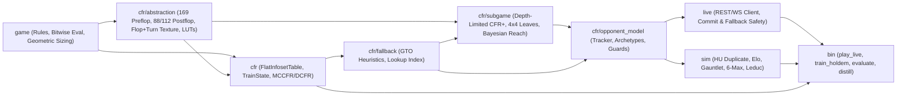
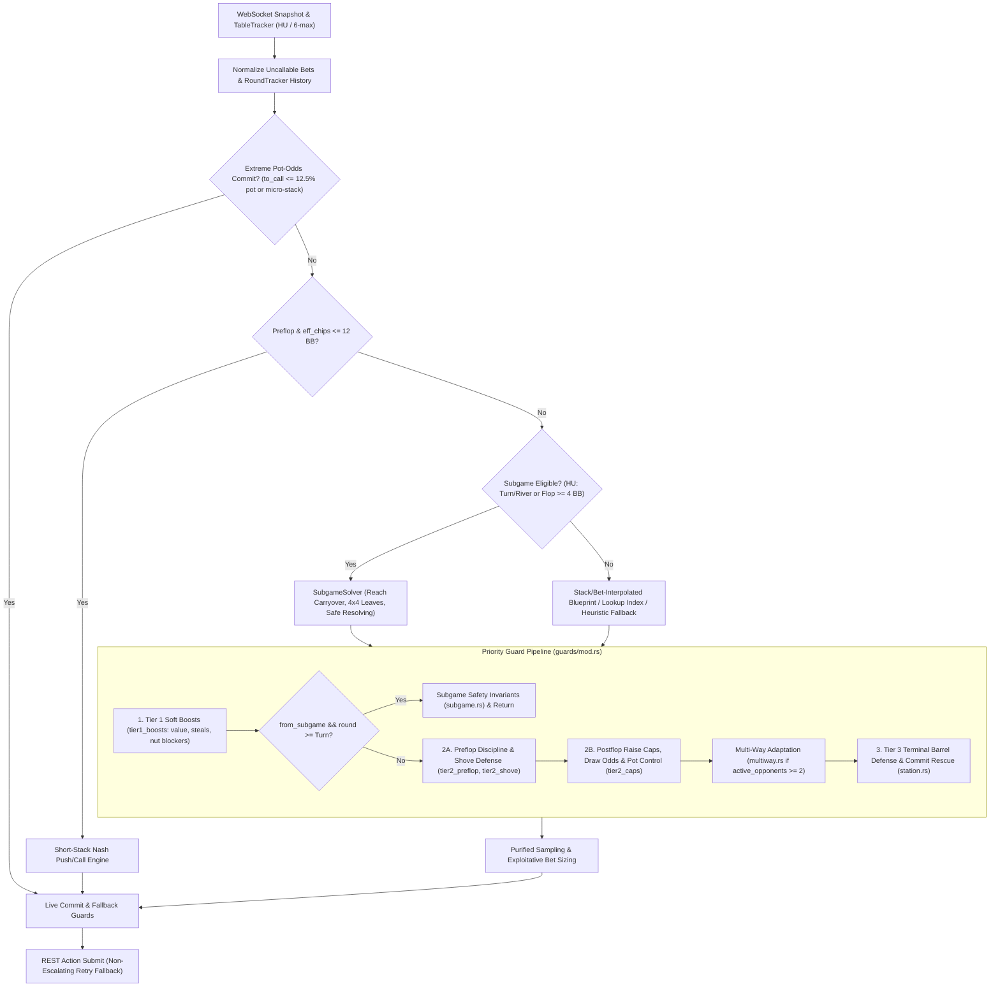

# System Architecture, Decision Pipeline & CLI Reference

Structural overview of `lil-poker-mccfr`, its real-time live decision & safety guard pipeline, model formats, and complete CLI reference.

> See [Algorithms & Engine Internals](algorithms.md) for CFR math, bitwise evaluation, lookup tables, and subgame solving details, or return to the [README](../README.md).

---

## 1. Subsystem Architecture



| Subsystem | Location | Responsibility |
| :--- | :--- | :--- |
| **Game Engine** | `src/game/` | Leduc & 52-card Texas Hold'em state machines, 1-based (`ROUND_*`) Hold'em street constants, geometric bet sizing, and $O(1)$ bitwise 7-card evaluator (`evaluate_7cards`). |
| **MCCFR Solver & Storage** | `src/cfr/` | Parallel DCFR/RBP Hold'em trainer (`holdem_mccfr.rs`), lock-free 5-bank SoA `FlatInfosetTable`, compact `TrainState`, Leduc MCCFR, and exact Vanilla CFR+. |
| **Card Abstraction** | `src/cfr/abstraction/` | 169 canonical preflop buckets, 88 base / 112 extended postflop buckets (`0..=111`), 4-state flop & 3-state turn textures, single-pass board/draw LUTs, and zero-alloc FNV-1a infoset key hashing. |
| **Online Subgame & Fallbacks** | `src/cfr/subgame/`, `src/cfr/fallback/` | Adaptive depth-limited Turn/River/Flop subgame resolver with cross-street `CachedReach` carryover, `OppStreetProfile` node locking, Pluribus-style `4×4` continuation leaves, safe resolving, `StrategyLookupIndex`, and stack-interpolated fallback lookup. |
| **Opponent Modeling & Guards** | `src/cfr/opponent_model/` | Persistent JSON profiles, VPIP/PFR/3-bet/c-bet/barrel stats, Wilson confidence bounds, showdown tells, style classification, short-stack Nash push/fold, and priority tactical guards. |
| **Live Client, Sim & Binaries** | `src/live/`, `src/sim/`, `src/bin/` | Tokio WebSocket/REST client (`play_live`), HU/6-max table state tracking, execution commit & non-escalating fallback guards, Duplicate/Elo/8-archetype Gauntlet/sweep benchmarks, and CLI tools. |

---

## 2. Live Decision & Priority Guard Pipeline

Every turn received by `play_live` (`src/live/client/mod.rs` → `src/live/decision.rs` → `src/cfr/opponent_model/guards/mod.rs`) passes through a deterministic safety and decision hierarchy:



### Live Execution & Rejected-Action Safety (`src/live/client/`)
* **Effective Stack Calculation** (`opp_chips: Option<i32>`): Separates unknown opponent stack (`None`, defaults to `my_chips`) from an all-in opponent (`Some(0)`, capping effective stack at `my_chips.min(to_call)`).
* **Live Commit Guards (`commit_guards.rs`)**: Prevents accidental over-commitment or stacking off with postflop air against oversized bets.
* **Non-Escalating Fallbacks (`fallback.rs`)**: If the server rejects an action (e.g., race/rounding), retry candidates strictly attempt non-escalating `check(0)` or `call(to_call)` → `call(0)` first, and only emit `all_in`/`allin` when `my_chips <= to_call`, when `call`/`check` are absent from `legal_actions`, or when the server error explicitly requires all-in.

---

## 3. Model Formats, Checkpoints & Distillation

* **Blueprint Strategy (`.bin` / `.json`)**: Compressed `f32` or JSON action probability maps indexed by infoset key. Compatible directly with `play_live`, `play`, `evaluate`, and `analyze_model`.
* **Lossless Solver State (`.ckpt`)**: Stores `(global_iterations, Vec<(hash, key, regret_sum, strategy_sum)>)` via `--save-raw-ckpt` so DCFR epochs and exact regret sums resume without reset drift.
* **Blueprint Compatibility**: Changing `src/cfr/abstraction/keys.rs`, preflop/postflop bucket numbering, or core sizing rules (`src/game/holdem/actions.rs`, `state.rs`) invalidates pre-trained `.bin` models. Changes inside `subgame/`, `opponent_model/`, `fallback/`, or `live/` apply at decision time with **no retraining required**.
* **Docker Distillation (< 400 MB RAM)**: `distill_model` prunes deep turn/river/preflop history nodes on disk so containerized `play_live` workers rely on real-time `SubgameSolver` on later streets under tight memory limits.

---

## 4. Complete CLI Reference

### Training Texas Hold'em (`train_holdem`)
```bash
cargo run --release --bin train_holdem -- \
  --iterations 200000000 \
  --threads 16 \
  --log-every 5000000 \
  --extended \
  --save-raw-ckpt \
  --save-path models/holdem_abstract_strategy.bin
```

| Flag | Default | Description |
| :--- | :--- | :--- |
| `-i, --iterations <N>` | `10000000` | Total MCCFR training iterations. |
| `-t, --threads <N>` | `16` | Number of Rayon worker threads. |
| `-l, --log-every <N>` | `50000` | Progress logging interval. |
| `-s, --save-path <PATH>` | `models/holdem_abstract_strategy.bin` | Output path for strategy binary/JSON. |
| `--checkpoint-every <N>` | `0` | Periodic checkpoint interval (`0` = disabled). |
| `--keep-checkpoints <bool>` | `true` | Retain per-checkpoint snapshot files. |
| `--rich-history <bool>` | `true` | Preserve prior-street betting context in infoset keys. |
| `--pruning <bool>` | `true` | Enable Regret-Based Pruning (RBP). |
| `--dcfr <bool>` | `true` | Enable Pluribus Discounted CFR (DCFR). |
| `--prune-river` | `false` | Drop river nodes on save for low-RAM deployment. |
| `--max-turn-actions <N>` | `0` | Cap retained turn actions on save (`0` = unlimited). |
| `--resume <PATH>` | — | Warm-start from an existing `.bin`/`.json` or `.ckpt` raw state. |
| `--save-raw-ckpt` | `false` | Write lossless `.ckpt` alongside the strategy file. |
| `--stack-bb <N>` | `100` | Starting effective stack depth when `--multi-stack` and `--extended` are false. |
| `--multi-stack` | `false` | Train unified `15 BB` / `30 BB` / `100 BB` blueprint in one file. |
| `--board-texture` | `false` | Include compact 4-state postflop flop texture (`d`/`w`/`p`/`m`). |
| `--short-stacks-only` | `false` | Train only short stacks (`15 BB` / `30 BB`, or `15 / 25 / 45 BB` with `--extended`), keeping `100 BB` frozen. |
| `--extended` | `false` | Enable extended abstraction (`112` postflop buckets, Flop+Turn textures, `15 / 25 / 45 / 100 BB` stack grid, 8M table slots). |

### Distillation & Model Inspection (`distill_model`, `analyze_model`)
```bash
# Compress blueprint for < 400 MB RAM Docker containers
cargo run --release --bin distill_model -- \
  models/holdem_abstract_strategy.bin \
  models/holdem_strategy_distilled.bin \
  --max-turn-actions 3 \
  --max-river-actions 3 \
  --max-pf-len 4 \
  --prune-river

# Inspect street counts, pure vs mixed breakdown, and search keys
cargo run --release --bin analyze_model -- \
  models/holdem_abstract_strategy.bin \
  --pattern "P:AA" \
  --limit 20
```

### Live Bot Client & Docker (`play_live`)
```bash
cargo run --release --bin play_live -- \
  --url http://localhost:8090 \
  --room 4XMSSW \
  --name Rust_CFR_Bot \
  --strategy models/holdem_abstract_strategy.bin \
  --subgame-search true
```
*(When `--strategy` uses the default path and `holdem_abstract_strategy.bin` is absent, `play_live` automatically falls back to `models/holdem_abstract_strategy.json` or `models/holdem_strategy_distilled.bin`.)*

```bash
# Auto-spawn image for the lil-poker web server
docker build -t lil-poker-mccfr .

# Standalone container
docker run --rm lil-poker-mccfr \
  --url http://host.docker.internal:8090 \
  --room 4XMSSW \
  --name Rust_CFR_Bot \
  --subgame-search
```

### Offline Play & Simulation (`play`)
```bash
# Simulate 100 hands vs built-in archetypes (random, tag, calling_station, maniac, rock, self)
cargo run --release --bin play -- --game holdem --hands 100 --opponent random --subgame-search

# Watch mode with step delay (ms)
cargo run --release --bin play -- --game holdem --mode watch --hands 10 --delay 500 --subgame-search
```
At session end, `play` outputs a HUD summary with net chip profit, win rate (`bb/100` & `mbb/hand`), and inferred opponent style.

### Evaluation & Benchmarking (`evaluate`)
```bash
# Duplicate HU vs archetype with subgame search
cargo run --release --bin evaluate -- \
  --game holdem --hands 5000 --opponent tag --duplicate true --subgame

# Sweep across 15 BB / 30 BB / 100 BB or rising tournament blinds
cargo run --release --bin evaluate -- --game holdem --hands 1000 --stack-sweep --subgame
cargo run --release --bin evaluate -- --game holdem --hands 1000 --blind-schedule --level-hands 20 --subgame

# 8-archetype Gauntlet, round-robin Duplicate Elo, or 6-max multiway table evaluation
cargo run --release --bin evaluate -- --game holdem --hands 1000 --opponent gauntlet --subgame
cargo run --release --bin evaluate -- --game holdem --hands 1000 --opponent elo --elo-dir models --subgame
cargo run --release --bin evaluate -- --game holdem --hands 1000 --opponent 6max --subgame

# A/B head-to-head match between two strategies (with deterministic seed)
cargo run --release --bin evaluate -- \
  --game holdem \
  --strategy models/holdem_abstract_strategy.bin \
  --opp-strategy models/holdem_strategy_distilled.bin \
  --hands 5000 --duplicate true --seed 2026

# Exact Leduc NashConv / Best Response analysis
cargo run --release --bin evaluate -- --game leduc --strategy models/leduc_strategy.json --hands 500000
```
Additional `evaluate` options: `--exploit-factor` (default `0.70`), `--stack-bb` (default `100`), `--disable-guard <CODES>` (comma-separated guard ablation), `--opponent ablate`, `--elo-dir <DIR>`, `--elo-models <PATHS>`, and `-v, --verbose`.

### Leduc Hold'em Training (`train`, `train_vanilla`)
```bash
# Parallel Leduc MCCFR
cargo run --release --bin train -- --iterations 200000 --threads 8 --save-path models/leduc_strategy.json

# Exact full-tree Vanilla CFR+
cargo run --release --bin train_vanilla -- --iterations 5000 --save-path models/leduc_vanilla.json
```

---

## 5. Integration Test Suites

Run `cargo test --all-targets` to execute all **147** deterministic integration tests across 8 test suites in `tests/`:

| Test Suite | Coverage |
| :--- | :--- |
| `tests/test_abstraction.rs` | Board texture codes, rich multi-street infoset keys & hashing |
| `tests/test_cfr.rs` | CFR+ regret clamping, DCFR discounting, `TrainState` & extended 4-tier/turn-texture `.ckpt` roundtrip |
| `tests/test_eval.rs` | 7-card evaluator tiebreakers, L1 LUT randomized parity, 88 base & 112 extended postflop buckets |
| `tests/test_fallback.rs` | Preflop/postflop GTO heuristics, `StrategyLookupIndex`, 3-/4-tier stack fallback & interpolation |
| `tests/test_game.rs` | Hold'em state transitions, geometric sizing, duplicate dealing, `overbet_aggro` archetype |
| `tests/test_live.rs` | Live protocol translation, HU/6-max snapshots, continuous bet-blend & non-escalating fallbacks |
| `tests/test_opponent.rs` | Metrics/Wilson bounds, style classification, sizing/station & preflop/postflop/subgame guards |
| `tests/test_subgame.rs` | Bayesian opponent/hero reach ranges, cross-street carryover, `4×4` continuation leaves, adaptive budgeting, multi-threaded solver |
